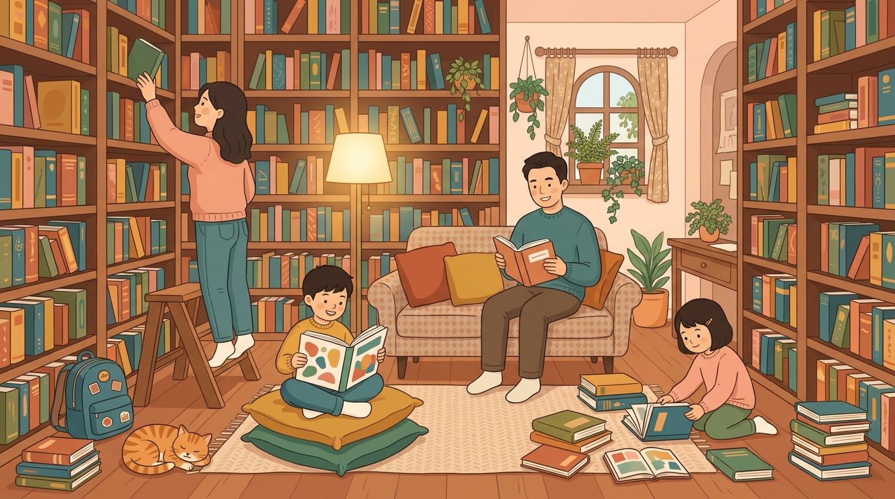
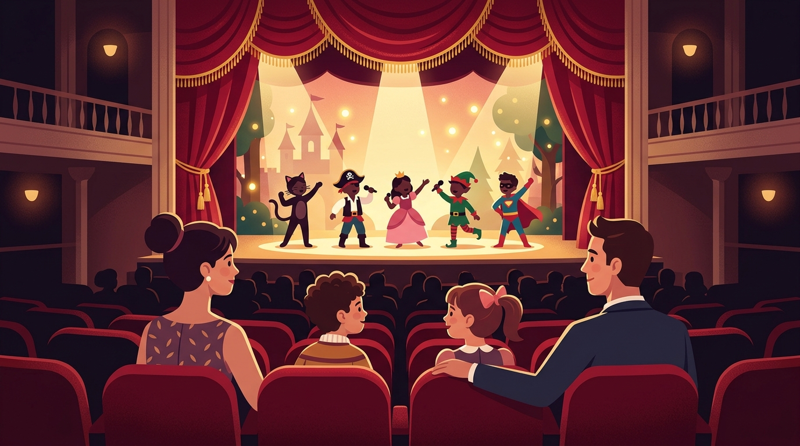
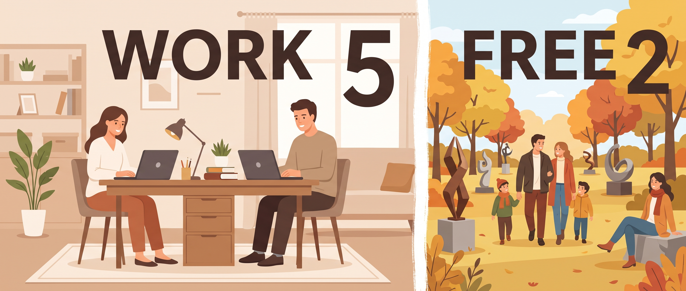

## Hi there 👋

<!--
**emiran0608/emiran0608** is a ✨ _special_ ✨ repository because its `README.md` (this file) appears on your GitHub profile.

Here are some ideas to get you started:

- 🔭 I’m currently working on ...
- 🌱 I’m currently learning ...
- 👯 I’m looking to collaborate on ...
- 🤔 I’m looking for help with ...
- 💬 Ask me about ...
- 📫 How to reach me: ...
- 😄 Pronouns: ...
- ⚡ Fun fact: ...
-->

# 🌟 안녕하세요, 일과 여유의 달인입니다!

> *"5일은 일하고, 2일은 자유롭게!"* — 저희 가족의 모토입니다.

---

## 🎭 뮤지컬 덕후네 집

우리 가족 4인, 전원 뮤지컬 애호가입니다!

| 구성원 | 뮤지컬 레벨 |
|:---:|:---|
| 👩 나 (엄마) | 🎫 시즌권급 단골, 관극 후기 장인 |
| 👨 아빠 | 🎫 함께 매달리는 진정한 관극 파트너 |
| 👦 아들 | 🎭 뮤지컬 어린이극단 활동 중 |
| 👧 딸 | 🎭 뮤지컬 어린이극단 활동 중 |

💡 *아이들의 무대를 보며 어쩌다 **대리만족** 중이라지만,
솔직히 저희가 더 행복합니다* 😆

---

## 📚 도서관 러버, 10년차

매달 **100권**을 빌리고 반납하는 도서관의 VIP 고객!

- 📖 10년째 이어온 도서관과의 로맨스
- 💪 *약간의 허영심*을 채우며... **책 읽는 가족인 척**도 절반
- 🏆 실제로는 모르는 책도 "아 그 책 재밌더라~"라고 말할 수 있는 수준 도달

> 도서관 사서선생님들이 저희 가족 얼굴은 다 아실 정도입니다. 죄송합니다, 그리고 감사합니다 🙏

---

## ⚖️ 오웍이프(5:2)의 삶

**5일 WORK + 2일 FREE = 나다운 삶**

평일엔 열심히, 주말엔 진짜로 삽니다.

🍂 **이번 10월의 주말 기록**

> 📍 **창원조각비엔날레** — 4개 곳곳을 매주 순례 중!
> 조각 작품과 가을 하늘 사이에서 힐링 완료 ✨

---

## 💬 한 줄 소개

> 무대 위 아이들과 극장 속 감동, 책장 넘기는 손끝의 여유,
> 주말의 자유까지 — **일상을 공연처럼, 주말을 여행처럼** 살아가는 사람입니다.

---

### 🤝 이런 분과 좋아요!

- 🎭 함께 관극할 뮤징(뮤지컬 친구)
- 📚 독서 코디네이터... 아니, 같이 책 이야기할 분
- 🗺️ 주말 나들이 동행자

*읽어주셔서 감사합니다! 잘 부탁드립니다* 🎈
